# My ESP P3A Amplifier Build (Y2026)

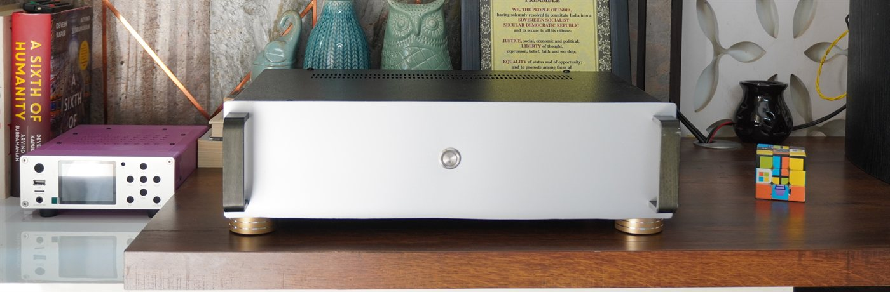

I have been making my own audio equipment since I was a teenager. I firmly believe that if you understand electronics, it is far better to build your own gear. You can craft something of exceptionally high quality, tailored precisely to your personal taste, and at a fraction of the cost of a mediocre commercial unit. For that matter, I build anything that I feel is not worth the retail price tag for its given quality—particularly in the domains of computers, electronics, and anything that can be 3D printed. Fortunately, all three are lifelong hobbies of mine.

Back in 2013–14, I built a stereo power amplifier for my home. My commercial home theater system (a mediocre setup received as a wedding gift) had given up the ghost, and repairing it was neither economical nor satisfying. I was unwilling to shell out exorbitant sums for high-end retail audio gear. After deep research across the DIY audio community, I chose to build a design by one of my greatest inspirations, Rod Elliott (Elliott Sound Products): the legendary [ESP Project 3A (P3A)](https://www.sound-au.com/project3a.htm). 

That 2013 amplifier was an absolute workhorse. It sounded magnificent and served faithfully for over a decade without missing a single beat. However, I was never 100% satisfied with the physical build. Back then in Bangalore, sourcing authentic, audiophile-grade components was an uphill battle involving difficult international orders, long customs delays, and DIY chemical etching of single-sided copper clad boards in my garage. The final unit lacked a professional finish and involved several mechanical compromises.

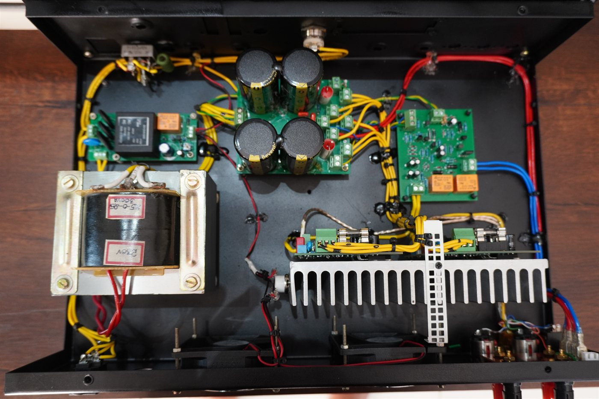

Fast forward to **2026**: I decided it was time to build a worthy successor. After re-evaluating modern DIY open-source topologies—from Class D modules to complex discrete designs—I reached the unmistakable conclusion that the **ESP P3A** is still King. Its Class AB topology is elegant, highly reliable, and delivers sound quality that easily rivals commercial amplifiers costing thousands of dollars. More importantly, the DIY landscape in India has completely transformed: quality passive components, genuine transistors, fast PCB fabrication (such as JLCPCB), and reputable domestic component distributors are now readily available. In 2026, I could finally build this amplifier to absolute perfection, with zero compromises.

---

## System Architecture & The 5 Building Blocks

A truly great power amplifier is not just an amplifier PCB; it is a carefully engineered system where the power supply, soft start, protection, and grounding work together in total harmony. 

This build integrates five core modules:

1. **The Amplifier Stage (ESP P3A)** – Dual-mono Class AB discrete power amplifier based on [Rod Elliott's ESP P3A](https://www.sound-au.com/project3a.htm).
2. **The Power Supply** – Ultra-low-noise linear power supply with a massive 40,000 µF reserve, inspired by Texas Instruments Reference Design [AN-1849: An Audio Amplifier Power Supply Design](https://www.ti.com/lit/an/snaa057c/snaa057c.pdf).
3. **The Soft Start Circuit** – Mains inrush limiter with auxiliary DC power, inspired by [ESP Project 39](https://www.sound-au.com/project39.htm).
4. **Speaker Protection & Fast Muting (ESP P33)** – DC offset sensing, turn-on delay, and instantaneous AC-loss drop-out based on [ESP Project 33](https://www.sound-au.com/project33.htm).
5. **The Ground Loop Breaker** – Safety earthing and hum-elimination network based on [Rod Elliott's Earthing Guide](https://www.sound-au.com/earthing.htm).

While planning the PCB layouts, I discovered that [gabriel-gearip](https://github.com/gabriel-gearip) had already produced clean, modular KiCad PCB layouts for both the P3A amplifier and P33 speaker protection boards. Check out his [GitHub repository](https://github.com/gabriel-gearip/p3a-amplifier). I chose to use his Gerber files directly for the P3A and P33 boards. For the **Power Supply** and **Soft Start**, I custom-designed the PCBs in KiCad to fit my chassis layout and ordered them fabricated via JLCPCB. Most components were procured domestically from [Robu.in](https://robu.in) and [Sharvi Electronics](https://sharvielectronics.com), along with trusted specialty suppliers.

---

## 1. The Amplifier: ESP P3A

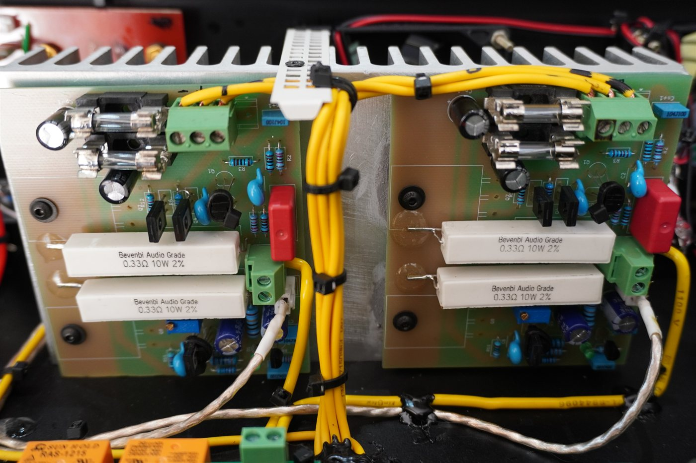

### The Topology
Rod Elliott's Project 3A is celebrated worldwide for good reason. It is a symmetrical-input, discrete Class AB power amplifier that avoids unnecessary complexity while delivering pristine linearity, wide bandwidth, and unconditional stability into real-world loudspeaker loads.

* **Input Stage**: A balanced differential pair (long-tailed pair) utilizing low-noise **BC546** NPN transistors (Q1, Q2) with emitter degeneration resistors ($1\text{ k}\Omega$). This maximizes open-loop linearity and slew rate while minimizing DC offset.
* **Voltage Amplification Stage (VAS)**: A high-current Class A VAS driven by a **BD140** (Q4). 
* **Bias Servo ($V_{be}$ Multiplier)**: Implemented with **Q9 (BC546)**. Because the P3A uses a **Compound Feedback Pair (CFP / Sziklai pair)** output stage, thermal stability is dictated by the driver transistors rather than the output power transistors. Accordingly, Q9 is thermally coupled directly to driver transistor **Q6 (BD140)**—tied face-to-face with thermal paste—rather than mounted on the main heatsink. Quiescent current adjustment is calibrated via a high-precision **Bourns 3296W** multi-turn potentiometer (RV1).
* **Driver & Output Stage**: High-speed **BD139/BD140** drivers feed a complementary pair of modern high-power audio transistors: the **NJW0281** (NPN) and **NJW0302** (PNP) in rugged TO-3P packages. Rated at 15 A, 250 V, and 150 W with an outstanding $30\text{ MHz}$ gain bandwidth, these ON Semiconductor devices exhibit extraordinary $h_{FE}$ linearity across their entire current swing.
* **Emitter Resistors**: Low-inductance **Bevenbi Audio Grade 0.33 $\Omega$ / 10 W** non-inductive ceramic power resistors ensure rock-solid current sharing and thermal stability.
* **On-Board Protection & Zobel**: Independent **3 A fast-blow DC rail fuses** right on each board protect against short circuits, while an on-board Zobel network ($10\ \Omega + 100\text{ nF}$) prevents high-frequency parasitic oscillation into reactive speaker cables.

### Power Output
Operating from $\pm 35\text{ V}$ DC rails, each mono block produces:
* **~60 W RMS into 8 $\Omega$**
* **~100 W RMS into 4 $\Omega$**

This is the sweet spot for domestic high-fidelity listening, providing ample clean headroom, high damping factor, and effortless dynamics without running into thermal or transformer saturation issues.

---

## 2. The Power Supply

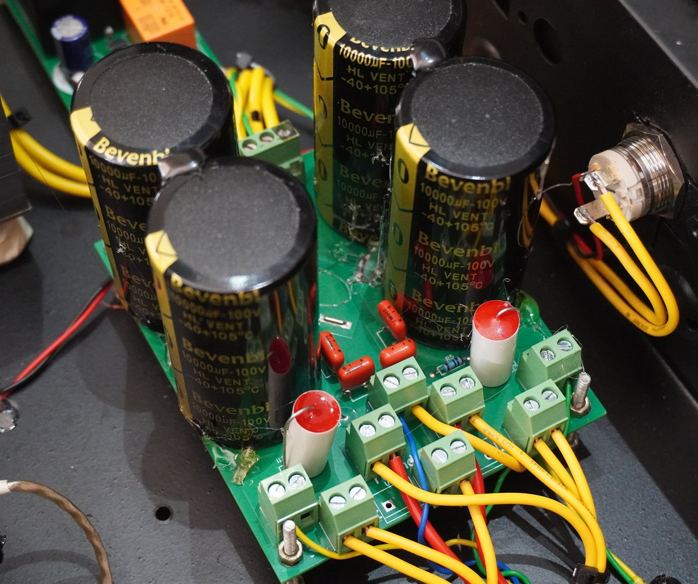

An audio amplifier is fundamentally an active valve that modulates raw DC from its power supply into an audio signal. If the power supply is noisy, under-capacitored, or poorly laid out, even the finest amplifier circuit will sound sluggish, hollow, and noisy.

For this build, I designed a dedicated heavy-duty dual-rail linear supply inspired by Texas Instruments' benchmark application report, [AN-1849: An Audio Amplifier Power Supply Design](https://www.ti.com/lit/an/snaa057c/snaa057c.pdf).

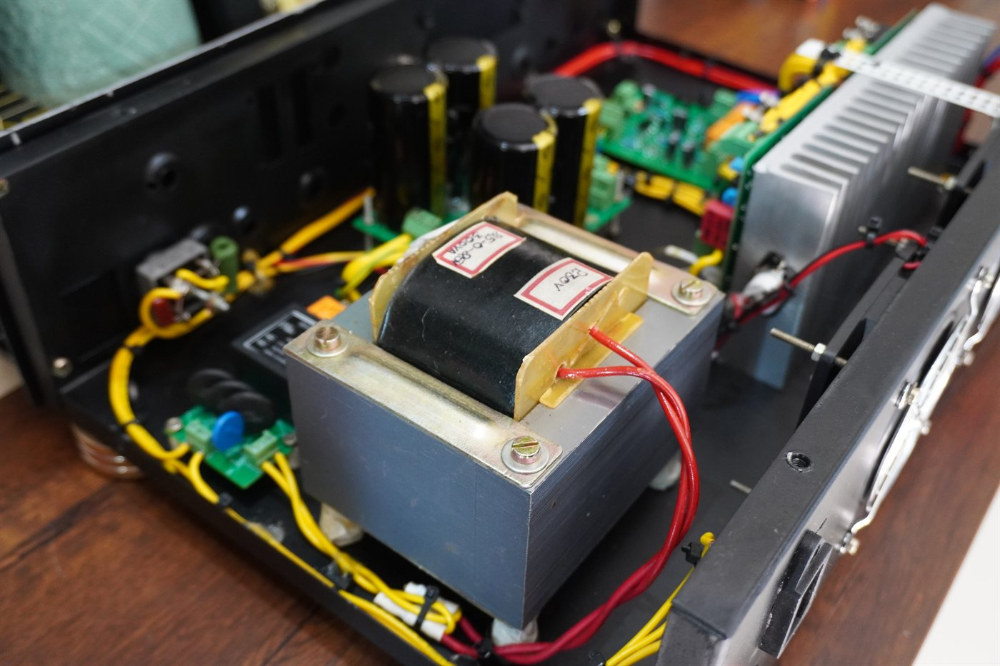

### Key Specifications & Design Highlights:
* **300 VA EI-Core Transformer**: Custom heavy-iron transformer with a $230\text{ V}$ AC primary and a **$25\text{--}0\text{--}25\text{ V}$ AC** center-tapped secondary. Under rectification, this produces clean $\pm 35.3\text{ V}$ DC unloaded, settling to a rock-solid $\pm 34\text{ V}$ to $\pm 35\text{ V}$ under continuous load. Mounted on rubber vibration-damping isolation mounts to eliminate mechanical hum.
* **40,000 µF Total Filter Reservoir**: Four massive **Bevenbi 10,000 µF / 100 V** high-ripple snap-in electrolytic capacitors provide **20,000 µF per rail**. This gargantuan capacitive reserve delivers instantaneous transient current for explosive bass slam and reduces 100 Hz ripple to mere millivolts.
* **Dual-Footprint High-Frequency Film Bypassing**: To filter out high-frequency noise and RF hash that large can electrolytics cannot absorb due to internal equivalent series inductance (ESL), premium film capacitors bypass each rail.
* **Diode Snubbers & Safety Bleeders**: High-voltage film snubber capacitors across the bridge rectifier legs suppress diode reverse-recovery ringing, while bleeder resistors safely drain the 40,000 µF filter bank when mains power is switched off.
* **Star Grounding Bus**: Thick, high-current copper star ground traces on the PCB provide clean, low-impedance ground return paths for both amplifier channels, the speaker ground terminals, and the center tap.

*(Need this custom PCB? email me at `rabindranathm@gmail.com`.)*

---

## 3. The Soft Start Circuit

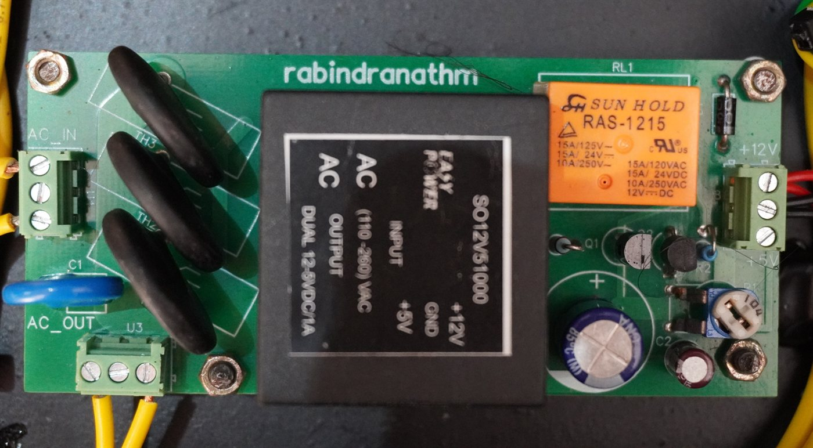

### The Problem
A 300 VA linear transformer coupled with a discharged 40,000 µF capacitor bank represents a dead short circuit at the split-second of turn-on. The instantaneous inrush current can spike to **30 to 50+ Amperes**, which routinely trips household miniature circuit breakers (MCBs), stresses or pits the mains power switch, and degrades rectifier diodes over time.

### The Solution: ESP Project 39 Architecture
Inspired by [ESP Project 39](https://www.sound-au.com/project39.htm), I designed a self-contained soft-start PCB that safely limits inrush current while adding isolated auxiliary power rails.

1. **Inrush Current Limiting**: Three heavy-duty **NTC thermistors** (TH1, TH2, TH3) are placed in series with the AC mains live feed. In their cold state, their combined resistance safely chokes the turn-on inrush current to a gentle few amperes.
2. **Precision Delay & Bypass**: An onboard isolated switch-mode power module (**EASY POWER SO12V51000**, accepting $110\text{--}260\text{ V}$ AC and outputting dual isolated $+12\text{ V}$ and $+5\text{ V}$ DC at 1 A) powers an RC timing circuit. After a controlled delay of approximately **1.5 to 2.0 seconds** (adjustable via an onboard 100 k$\Omega$ trimpot), transistor Q1 turns on and energizes a heavy-duty **SUN HOLD RAS-1215 15 A relay**. The relay contacts short out the NTC thermistors, delivering 100% unimpeded AC mains to the main transformer.
3. **Auxiliary Dual DC Power (+12V & +5V)**: Generating isolated low-voltage DC directly on the soft-start board provides two versatile auxiliary rails:
   * **$+12\text{ V}$ DC**: Powers the **dual chassis exhaust fans** and the **illuminated front-panel power switch LED halo ring**, keeping fan motor commutation hash completely isolated from the sensitive audio rails.
   * **$+5\text{ V}$ DC**: A dedicated clean 5V rail that can be used to power internal or add-on **Bluetooth audio receiver modules** (such as CSR8675, PCM5102, or QCC series boards) or USB DACs without requiring an extra wall wart or inducing digital ground hum into the analog signal path!

*(Need this custom PCB? email me at `rabindranathm@gmail.com`.)*

---

## 4. The Speaker Protection and Muting: ESP P33

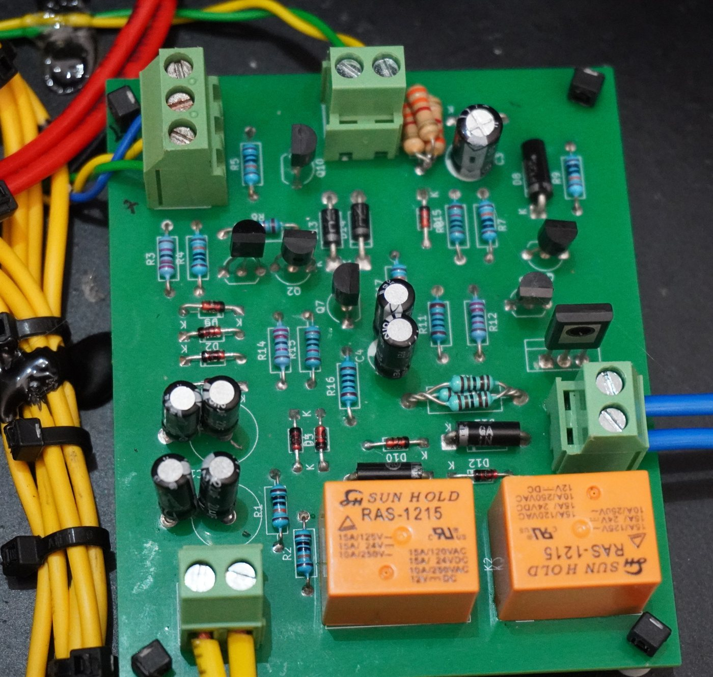

High-end loudspeakers are a substantial investment. Because direct-coupled solid-state amplifiers like the P3A do not have output transformers or DC-blocking capacitors, a catastrophic failure of an output transistor would immediately dump the full $\pm 35\text{ V}$ DC rail across your loudspeaker's voice coil, burning it to a crisp in fractions of a second.

To safeguard against this, I incorporated [ESP Project 33](https://www.sound-au.com/project33.htm), built on Gabriel Gearip's PCB layout. This circuit provides three critical protective functions:

### 1. Turn-On Delay (Anti-Thump)
When power is applied, the output relays (**SUN HOLD RAS-1215 15 A**) remain open for **3 to 5 seconds**. This allows the power supply rails to stabilize and DC operating points to settle into equilibrium before the speakers are engaged, ensuring complete silence at turn-on without any annoying "thump" or pop.

### 2. Fast DC Offset Fault Detection
Audio signals are AC; continuous DC should never reach a speaker. The output of both amplifier channels is monitored via a balanced RC low-pass filter (C1, C2 and 100 k$\Omega$ resistors). If either a positive or negative DC offset exceeding $\sim 1.5\text{ V}$ is detected on either channel (caused by component failure or severe overdrive), the sensing transistors trigger instantaneously, de-energizing the relays and disconnecting the speakers in milliseconds.

### 3. Fast Loss-of-AC Power-Off Muting
A dedicated detection input monitors the raw AC line from the transformer secondary. The instant you flip the mains switch to OFF, the incoming AC sine wave vanishes within one half-cycle ($\sim 10\text{--}20\text{ ms}$). The circuit detects this AC loss immediately and drops the speaker relays before the massive 40,000 µF filter capacitors have a chance to slowly drain down. This completely eliminates the squeaks, thumps, or distorted distortion bursts typical of powering off an un-muted amplifier.

---

## 5. The Ground Loop Breaker

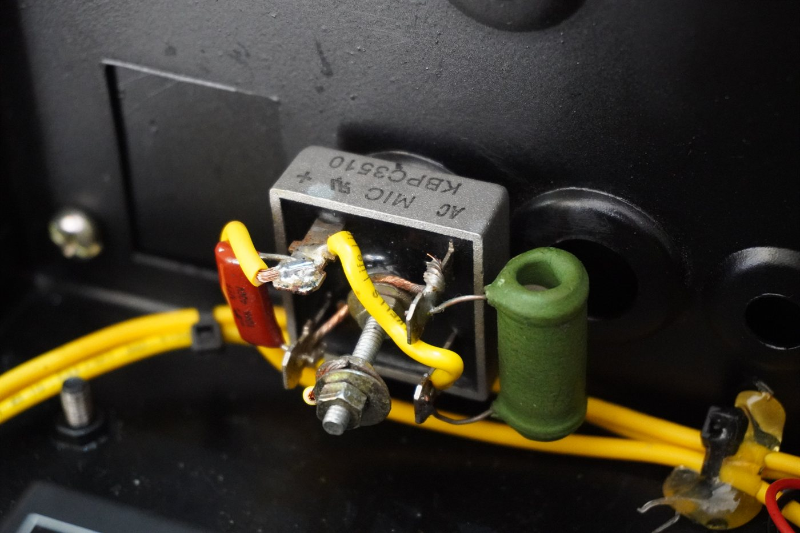

Building a truly silent, hum-free audio amplifier requires mastering the art of grounding. 

### The Audiophile Dilemma
* **Electrical Safety**: Mains safety earth (the green/yellow conductor from the IEC inlet) must be securely bolted to the metal chassis. If an internal mains wire ever comes loose or chafes against the metal case, the fault current must trip the home breaker rather than electrifying the chassis and endangering your life.
* **The Ground Loop Problem**: If you directly connect the internal audio signal ground ($0\text{ V}$) to the chassis earth, connecting external audio sources (like a computer, TV, active subwoofer, or DAC) creates a closed loop through the mains safety earth and the audio interconnect shields. Circulating eddy currents induce irritating **50 Hz mains hum** and **100 Hz harmonic buzz** directly into the signal path.

### Rod Elliott's Proven Safety Breaker
Following [Rod Elliott's Earthing Guide](https://www.sound-au.com/earthing.htm), I constructed a dedicated ground-loop isolation bridge bolted directly to the chassis floor:

1. **High-Current Bridge Rectifier (MIC KBPC3510)**: A heavy-duty $35\text{ A} / 1000\text{ V}$ metal-cased bridge rectifier. The two AC terminals are shorted together, and the positive ($+$) and negative ($-$) terminals are shorted together. This forms two pairs of high-current silicon diodes connected in inverse-parallel.
2. **Parallel 10 $\Omega$ / 5 W Ceramic Resistor**: Keeps the internal signal ground referenced near chassis potential while damping any circulating RF currents.
3. **Parallel 100 nF / 400 V Class Film Capacitor**: Shunts radio frequency interference (RFI) and high-frequency EMI noise harmlessly into the chassis shield.

### How It Works in Practice:
* **Under Normal Conditions**: Ground-loop noise voltages are typically tens of millivolts—well below the $\sim 0.7\text{ V}$ conduction threshold of the silicon diodes. The $10\ \Omega$ resistor breaks the low-resistance loop, resulting in a dead-quiet, pitch-black noise floor with zero audible hum at the speaker cones.
* **Under Fault Conditions**: If a catastrophic short occurs (e.g., $230\text{ V}$ mains contacting the audio ground), the voltage immediately exceeds $0.7\text{ V}$. The massive $35\text{ A}$ diodes turn on hard, safely conducting hundreds of amperes of fault current directly into safety earth, instantly blowing the mains fuse before any lethal voltage can appear on external equipment or the chassis.

---

## Optimizations & Field Tweaks

During assembly, testing, and listening sessions, I implemented two crucial optimizations that resolved real-world issues and elevated the amplifier's performance:

### 1. P3A Miller Capacitor (C4): Upgraded to 56 pF Silver Mica
* **The Original Spec**: The default P3A bill of materials specifies a standard $100\text{ pF}$ ceramic disc capacitor for C4 (the Miller compensation capacitor across the VAS transistor BD140).
* **The Issue**: Standard ceramic disc capacitors have significant dielectric absorption and voltage-dependent capacitance variations, which introduce subtle non-linearities in the high-frequency feedback loop. Furthermore, $100\text{ pF}$ provides a very conservative dominant pole that slightly restricts the amplifier's slew rate.
* **The Upgrade**: I replaced C4 with a high-precision **56 pF Silver Mica** capacitor. Silver mica is revered in high-end audio for its ultra-low dielectric loss, extreme thermal stability, and low distortion. Reducing the value to $56\text{ pF}$ safely maintained ample phase margin while noticeably improving slew rate, resulting in airier, more transparent treble, sweeter vocal decay, and an expansive soundstage without any trace of ringing or instability.

### 2. P33 AC Detection Filter Capacitor: Increased from 1 µF to 10 µF
* **The Issue**: When testing the P33 protection circuit on India's $50\text{ Hz}$ AC mains grid, the relays began **chattering and switching intermittently at 50 Hz**! The original design had assumed a $1\text{ µF}$ capacitor on the rectified AC sensing node. At $50\text{ Hz}$ (where the ripple frequency is lower than $60\text{ Hz}$), the voltage valley between rectified peaks dipped below the threshold of the sensing transistor, causing the relay drive to cycle at mains frequency.
* **The Fix**: I changed the AC detection smoothing capacitor from **$1\text{ µF}$ to $10\text{ µF}$**. This smoothed the rectified DC voltage sufficiently to hold the relay driver rock-solid during operation, while still maintaining lightning-fast drop-out ($<50\text{ ms}$) the moment mains power is cut.

---

## Enclosure, Thermal Design & Wiring

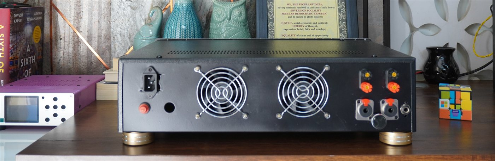

A professional amplifier deserves a chassis that matches its electrical performance.

* **Chassis & Aesthetics**: Housed in a rigid steel enclosure with a custom CNC-milled, bead-blasted anodized aluminum front panel with heavy-duty rack handles. A center-mounted, flush stainless-steel pushbutton switch with a soft LED halo provides a clean, minimalist face. Gold-accented isolation feet decouple the chassis from furniture vibrations.
* **Thermal Management**: The amplifier boards are bolted to a generous finned aluminum heatsink. Two low-RPM, whisper-quiet exhaust fans with chrome wire grilles pull cool air directly through the heatsink fins and exhaust it out the rear panel, keeping operating temperatures barely lukewarm even during long, loud listening sessions.
* **Rear Panel Connectivity**:
  * Filtered IEC mains power inlet with an integrated fuse holder and master rocker switch.
  * Heavy-duty, gold-plated 5-way speaker binding posts accepting bare wire, spades, or banana plugs.
  * Professional **MX 6.35 mm TRS Female Jack Secure Panel Mount** connectors with positive-locking release latches and isolated chassis bushings for rock-solid, professional audio input connections.
* **Wiring Discipline**:
  * Mains AC wiring is kept strictly confined to the far-left side of the chassis.
  * High-current DC power leads (yellow/blue) are tightly bundled, zip-tied, and anchored to the chassis floor.
  * Low-level audio input lines use double-shielded, grounded audio cables routed far away from the transformer and AC mains leads.

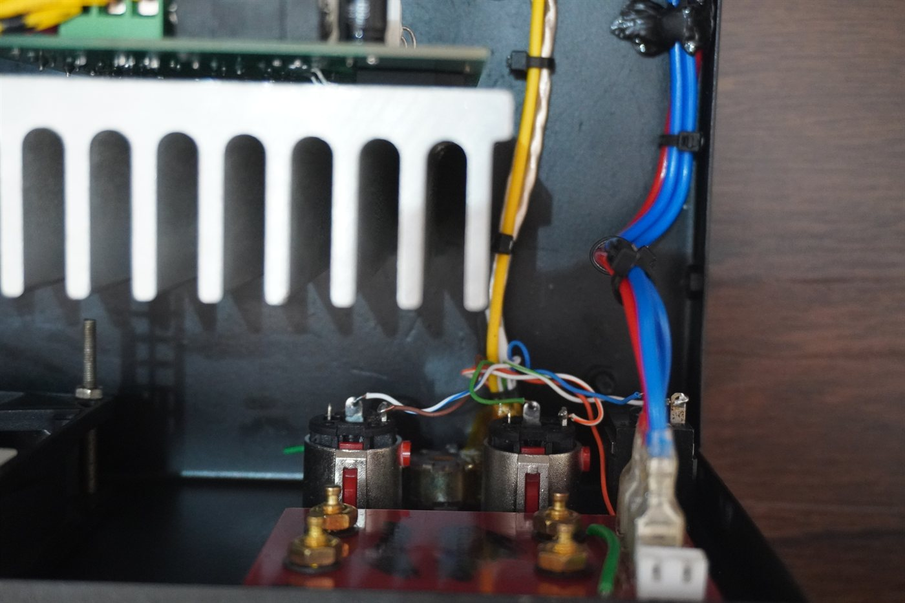

---

## Tips, Tricks & Component Selection Guide

Building a high-fidelity amplifier that performs flawlessly for decades requires paying close attention to component types, tolerances, and mechanical assembly. Cutting corners on a 50-cent passive component or neglecting thermal insulation can cause instability, noise, or instant device destruction. 

Here are the hard-won practical guidelines distilled from Rod Elliott's design notes, TI's AN-1849 application report, and my own hands-on build experience:

### 1. Resistor Selection: Where Type & Wattage Matter

Not all resistors are created equal. The operating conditions determine the ideal resistor chemistry:

| Position | Recommended Value / Spec | Resistor Type & Why |
| :--- | :--- | :--- |
| **Small-Signal Audio Path** (R1–R8, feedback network) | 1/4W to 1/2W, 1% tolerance | **Metal Film (MF)**: Metal film resistors generate significantly lower thermal (Johnson) noise and have negligible voltage coefficient compared to carbon film/carbon composition. They keep the amplifier’s noise floor dead silent. |
| **VAS & Pre-Driver Loading** (P3A R9, R10) | 3.3 k$\Omega$, 1/2W to 1W | **Metal Film or Flameproof Metal Oxide**: These resistors continuously drop voltage from the $\pm 35\text{V}$ rails and run warm. Use at least 0.5W or 1W rating to prevent thermal drift and long-term degradation. |
| **Output Emitter Resistors** (P3A R13, R14) | 0.33 $\Omega$, 5W to 10W | **Non-Inductive Ceramic / Metal Oxide**: *Critical!* Standard cheap spiral-wound wirewound resistors introduce parasitic inductance ($L$) at high frequencies. With modern high-speed output transistors like the NJW0281/NJW0302 ($f_T = 30\text{ MHz}$), inductive emitter resistors can trigger ultrasonic ringing or oscillation. Use dedicated low-inductance audio-grade resistors (e.g., Bevenbi Audio Grade 10W non-inductive ceramic). |
| **Zobel Network Resistor** (P3A R15) | 10 $\Omega$, 1/2W to 1W | **Flameproof Metal Oxide / Non-Inductive**: Absorbs high-frequency capacitive energy. Must be flameproof in case of severe high-frequency parasitic oscillation. |
| **Power Dropping Resistors** (P33 R10, R13; PSU bleeders) | Varied (1W to 5W) | **Power Resistors mounted with clearance**: Resistors that drop rail voltage to zener diodes or relays dissipate real heat. **Mount them 1 to 2 mm above the PCB surface** rather than flush against the board to allow air convection and avoid scorching the fiberglass PCB over years of operation. |

---

### 2. Capacitor Selection: Dielectrics & Voltage Ratings

Capacitor dielectric material has a profound effect on audio transparency, frequency response, and circuit reliability:

* **Input DC-Blocking Capacitor (P3A C1 – 4.7 µF)**:
  * **Use**: High-quality **metallized polyester (PET) or metallized polypropylene (PP)** film capacitor (such as WIMA MKS/MKP or Epcos), rated for $50\text{V}$ or $63\text{V}$.
  * **Avoid**: Never use polarized electrolytics or cheap ceramic discs here. Film capacitors eliminate dielectric distortion and preserve deep, articulated bass without phase smear.
* **Miller Compensation Capacitor (P3A C4 – 56 pF to 100 pF)**:
  * **Use**: **Silver Mica** or **C0G / NP0 Ceramic**. Silver mica is the gold standard here due to its ultra-low dielectric absorption, zero voltage coefficient, and extreme temperature stability.
  * **Avoid**: *Never* use Class 2 or 3 generic ceramics (X7R, Z5U, Y5V). Their capacitance shifts wildly with voltage swing, which injects severe non-linear harmonic distortion directly into the amplifier's dominant feedback loop!
* **High-Frequency Compensation (P3A C2, C6 – 100 pF)**:
  * **Use**: High-stability **C0G / NP0 ceramic** or silver mica.
* **Speaker Protection Sensing Capacitors (P33 C1, C2 – 10 µF)**:
  * **Use**: **Non-Polar (Bipolar / NP)** electrolytic capacitors rated at $25\text{V}$ to $50\text{V}$ (or two $22\text{ µF}$ polarized electrolytics wired in series back-to-back, negative-to-negative).
  * **Why**: The DC detection circuit samples bidirectional AC audio signals. A standard polarized electrolytic will be reverse-biased during negative audio peaks, leading to leakage current, distorted sensing, and false relay tripping.
* **Main Filter Reservoir (Power Supply – 10,000 µF / 100V)**:
  * **Use**: High-ripple-current, low-ESR, $105^\circ\text{C}$ snap-in audio-grade electrolytics.
  * **Voltage Margin**: On $\pm 35\text{V}$ rails, using $100\text{V}$ rated capacitors gives massive dielectric margin against surges, lowers ESR, and guarantees decades of maintenance-free service without drying out.
* **High-Frequency RF Bypass Capacitors**:
  * **Use**: $100\text{ nF}$ metallized film capacitors paralleled across the bridge rectifier legs and placed directly at the amplifier board DC inputs. Large can electrolytics have internal equivalent series inductance (ESL) and become ineffective above tens of kilohertz; film bypass capacitors maintain low rail impedance into the multi-megahertz region.

---

### 3. Special Care & Assembly Precautions

Pay meticulous attention to these mechanical and electrical details during assembly:

> [!CAUTION]
> **Heatsink Transistor Insulation (The #1 Killer of DIY Amplifiers)**
> The metal collector tabs of the TO-3P output transistors (**NJW0281** and **NJW0302**) and driver transistors are **electrically hot**—tied directly to the positive and negative power rails!
> * Mount every power transistor using an individual **mica insulator, Kapton washer, or Bergquist Sil-Pad**, along with an insulating shoulder washer for the mounting screw.
> * Apply a very thin, uniform film of high-quality thermal grease (e.g., Arctic MX-4 or silicone heatsink compound) on both sides of mica washers. Avoid excessive paste, which increases thermal resistance.
> * **MANDATORY MULTIMETER CHECK**: Before applying any power, use your digital multimeter in continuity / resistance mode to test between the collector tab / mounting screw of **every single transistor** and the aluminum heatsink. It MUST read **infinite resistance (open circuit)**. Even a microscopic metal swarf or burr puncturing the mica will short the full DC rail to ground, instantly destroying output transistors upon power-up.

> [!IMPORTANT]
> **Thermal Coupling of the Bias Servo ($V_{be}$ Multiplier): Q9 Tied Directly to Driver Q6**
> One of the most elegant design choices in Rod Elliott's P3A is the use of a **Compound Feedback Pair (CFP / Sziklai pair)** output stage:
> * Unlike standard Darlington (Emitter Follower) amplifiers where the bias transistor must be bolted to the main heatsink, a CFP output stage has 100% local negative feedback around each driver/output pair. As a result, the output stage quiescent current is governed by the $V_{be}$ of the **driver transistors**, not the high-power output transistors!
> * Therefore, **Q9 (BC546)** acts as the bias servo ($V_{be}$ multiplier) and is **thermally coupled directly to driver transistor Q6 (BD140)**. In this build—just as Rod Elliott designed—the flat faces of Q9 and Q6 are placed touching face-to-face with a thin film of thermal grease and tied tightly together using a small zip-tie or heatshrink sleeve.
> * **DO NOT mount Q9 on the main heatsink!** Mounting the bias transistor to the main heatsink in a CFP amplifier leads to sluggish, improper thermal tracking. By tying Q9 directly to driver Q6 right on the PCB, Q9 immediately senses any temperature rise in the driver and automatically reduces the bias voltage, preventing thermal runaway and keeping idle current rock-steady across all listening levels.

> [!TIP]
> **Transistor Matching for Minimal DC Offset & Symmetrical Drive**
> * **Input Differential Pair (Q1, Q2 - BC546B)**: Take 10 to 15 pieces of low-cost BC546B transistors and measure their DC current gain ($h_{FE}$) using a multimeter transistor tester. Select two matched pairs whose $h_{FE}$ values are within **5% to 10%** of each other (one pair for the Left channel, one pair for the Right channel). Symmetrical matching of the input pair ensures the amplifier's DC output offset stays well under **$15\text{ mV}$** at all times, without requiring a DC offset potentiometer or an active DC servo circuit!
> * **Driver & Power Transistors**: If possible, also hand-match complementary pairs in the driver stage (BD139/BD140) and power output stage (NJW0281/NJW0302) for closely matched $h_{FE}$ between positive and negative halves. This ensures symmetrical slew rates and further minimizes even-order harmonic distortion.

> [!NOTE]
> **Wiring & Routing Discipline**
> * **Twist All AC Conductors**: Tightly twist the $230\text{V}$ AC mains leads (Live and Neutral), as well as the transformer secondary AC pairs ($25\text{--}0\text{--}25\text{V}$). Twisting ensures the magnetic fields generated by the heavy alternating currents cancel each other out, preventing hum induction.
> * **Strict Star Grounding**: Never daisy-chain ground wires from one board to another. Every ground connection—power supply center tap, Left amplifier ground, Right amplifier ground, speaker return terminals, and soft-start ground—must run independently back to the heavy central ground bus on the power supply PCB.
> * **Separate Signal Ground from Power Ground**: Small-signal input ground carries minuscule audio currents (microamps), whereas the power ground handles massive speaker return currents (several amps). To prevent heavy speaker currents and supply ripple from modulating the input reference, maintain strict separation between clean signal ground and dirty power ground, tying them together only at the central star point.
> * **Route Small-Signal Lines Away from AC**: Keep low-level shielded audio input cables on the opposite side of the chassis from the AC mains wiring. Where AC and audio signal wires must cross, ensure they cross at a **$90^\circ$ right angle** to minimize capacitive and inductive crosstalk.

---

## Initial Testing & Biasing Guide

If you are building your own ESP P3A, follow this step-by-step commissioning procedure before connecting your prized speakers:

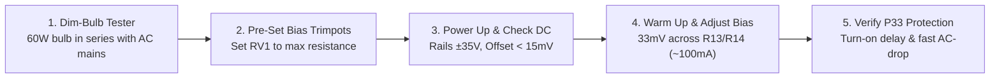

1. **Use a Dim-Bulb Tester**: On initial power-up, wire a $60\text{ W}$ or $100\text{ W}$ incandescent light bulb in series with the AC mains live wire. If there is a short or soldering bridge, the bulb will glow brightly and protect your output transistors from instant destruction. If all is well, the bulb will flare briefly (as the filter caps charge) and then dim to a faint orange glow.
2. **Pre-Set the Bias Trimpots**: Before applying power, turn the **RV1** multiturn trimpot on both amplifier boards to its **maximum resistance**. This ensures the amplifier turns on with minimum quiescent current (zero bias).
3. **Verify DC Offset**: With no input signal and no speakers connected, measure the DC voltage across the speaker output terminals. It should read under $\pm 20\text{ mV}$ (typically $5\text{--}15\text{ mV}$).
4. **Set Quiescent Bias Current**:
   * Remove the dim-bulb tester and plug directly into mains.
   * Allow the amplifier to idle for 10 minutes to reach operating temperature.
   * Connect a digital multimeter (set to millivolts DC) across one of the $0.33\ \Omega$ emitter resistors (**R13** or **R14**).
   * Slowly rotate trimpot **RV1** until the multimeter reads **$33\text{ mV}$**.
   * By Ohm's Law:
     $$I_{bias} = \frac{V}{R} = \frac{33\text{ mV}}{0.33\ \Omega} = 100\text{ mA}$$
   * A bias current of $100\text{ mA}$ per channel provides ideal Class AB linearity, eliminating crossover distortion while keeping idle dissipation conservative.
   * Re-check the voltage after 30 minutes of warmup and make fine adjustments if necessary.
5. **Verify P33 Operation**:
   * Listen for the crisp click of the P33 speaker relays approximately 3 to 4 seconds after power-on.
   * Power down the amplifier: the relays must click open instantly without the slightest lag, confirming that the AC-loss muting is functioning properly.

---

## Parts Sourcing & PCB Availability

Building an audiophile-grade amplifier in India is now completely viable with local resources:

| Component Category | Recommended Sources | Notes |
| :--- | :--- | :--- |
| **P3A & P33 PCBs** | [gabriel-gearip GitHub](https://github.com/gabriel-gearip/p3a-amplifier) | Download Gerbers & order from JLCPCB |
| **Power Supply PCB** | Contact author (`rabindranathm@gmail.com`) | Custom KiCad layout, JLCPCB 2-layer |
| **Soft Start PCB** | Contact author (`rabindranathm@gmail.com`) | Custom KiCad layout, JLCPCB 2-layer |
| **Passives & Relays** | [Robu.in](https://robu.in), [Sharvi Electronics](https://sharvielectronics.com) | Metal film 1% resistors, Bourns trimmers, Finder/Sun Hold relays |
| **Filter Capacitors** | Bevenbi Audio Grade (10,000 µF / 100 V) | diyaudiocart.com |
| **Transistors** | Robu.in, MV Collection | Authentic ON Semi NJW0281/NJW0302, BD139/140, BC546 |
| **Transformer** | Local transformer winder (Bangalore) | 300 VA EI core, $230\text{ V}$ primary, $25\text{--}0\text{--}25\text{ V}$ secondary |
| **Hardware & Chassis** | 17.5" 2U Cabinet, MV Collection | Finned aluminum heatsink, MX 6.35 mm TRS locking jacks, gold binding posts |

---

## Conclusion & Listening Impressions

Rebuilding the ESP P3A in 2026 was one of the most rewarding audio projects I have undertaken. Seeing the amplifier take shape—from clean KiCad layouts and freshly etched JLCPCB boards to a gleaming, professionally wired chassis—has been immensely satisfying.

How does it sound? Great!; clean, warm, musical, dynamic. 

The combination of the stiff 300 VA transformer and 40,000 µF filter reserve gives the amplifier unflinching grip over the woofer cones. Low-frequency bass notes are fast, punchy, and deeply textured with zero muddiness. The midrange is transparent and organic, rendering acoustic instruments and vocals with uncanny realism. And thanks to the 56 pF Silver Mica Miller capacitor upgrade, the highs are smooth, airy, and fatigue-free even during multi-hour listening sessions. Most impressively, the ground loop breaker and star ground layout ensure the background is pitch black—not even a trace of hiss or hum can be heard with your ear pressed directly against the tweeter.

If you have been contemplating building your own high-fidelity amplifier, look no further than the ESP P3A. It is a timeless masterpiece of audio engineering that will reward you with decades of musical joy.

Happy building!

---
*Created by Rabindranath Mishra.*  
*If you have questions about the build, need the custom Power Supply or Soft Start Gerbers, or want component tips, feel free to open an issue or reach out at `rabindranathm@gmail.com`.*
